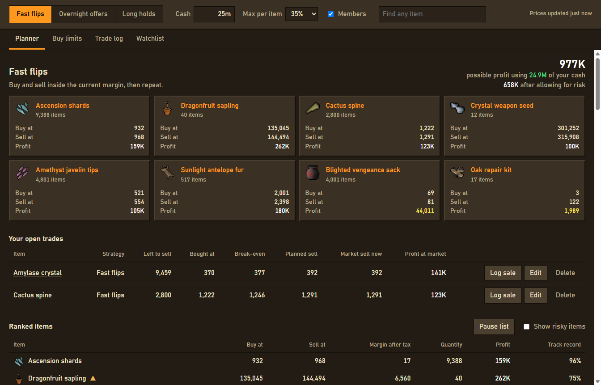
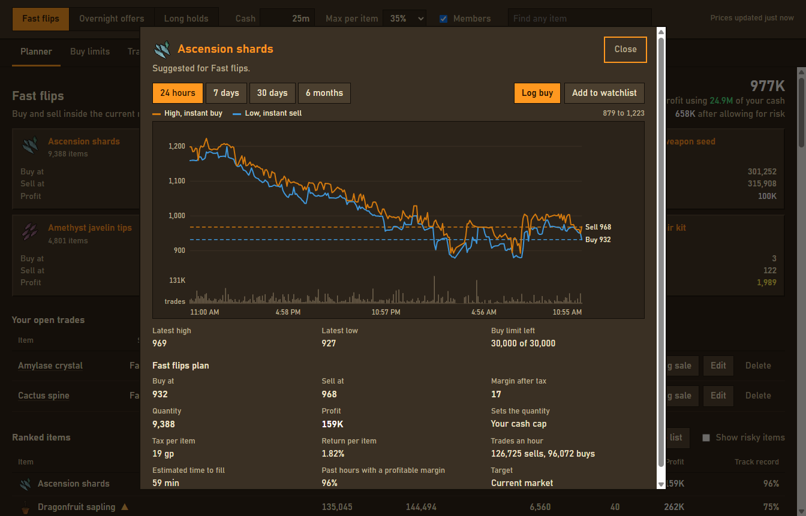
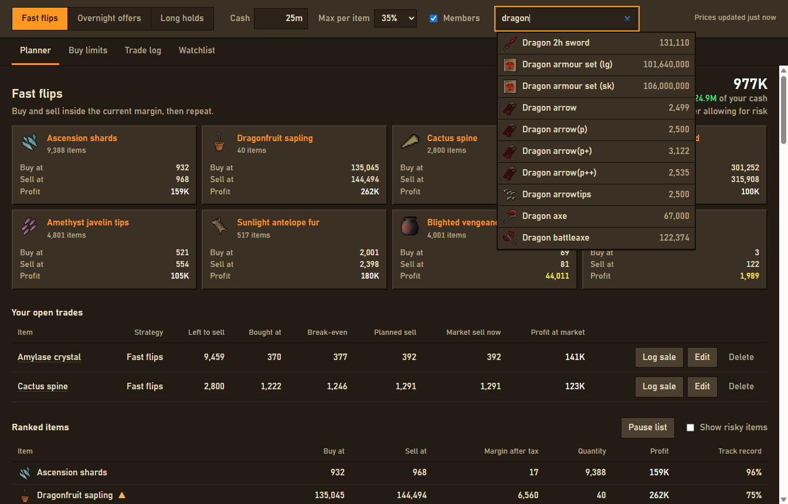
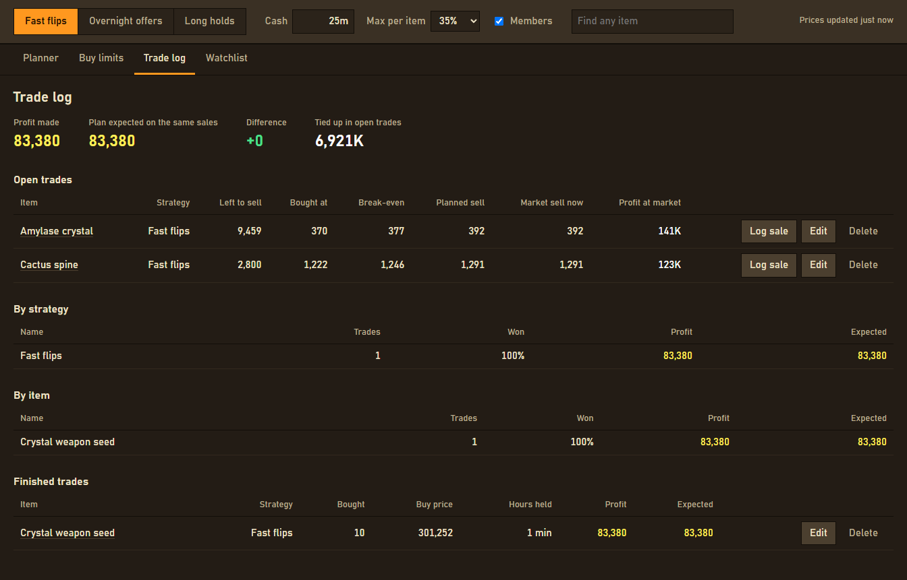

# OSRS Merch Planner

A personal Grand Exchange planner. It suggests offers for your GE slots, tracks buy limits, and compares your results with the plan. It only reads public price data and never touches the game client: you place every offer yourself.

## Screenshots

Plan your GE slots, then track your open trades against break-even and the current market.

Open any item to see its price chart, the suggested offers, and why it does or doesn't qualify.

Search every item on the Grand Exchange, including ones the rankings leave out.

Compare what you made with what the plan expected, by strategy and by item.

The screenshots use live prices and sample trades.

## Install it

Download the latest `OSRS-Merch-Planner-Setup` file from the [Releases page](https://github.com/williamstylerg/OSRS_Merching_Tool/releases) and run it. The installer isn't code-signed, so Windows may show a SmartScreen warning: choose **More info**, then **Run anyway**.

## Run it from source

    npm install
    npm start

## Check it

    npm test            # calculation and data tests, no network
    npm run smoke:live  # checks the real Wiki price API and prints sample rankings

## Build an installer

    npm run dist

Test the installed app, not just `npm start`, before relying on a build.

## How it fits together

- `src-main/engine/`: tax, strategy settings, scoring, slot planning, and trade maths. No Electron or network code.
- `src-main/services/`: Wiki price client and cache, saved data, and the view sent to the interface.
- `main.js`, `preload.js`: Electron window and the bridge to the interface.
- `index.html`, `styles.css`, `src/`: the interface. There is no build step.

To tune a strategy, edit `src-main/engine/modes.js`. Tax rules and exempt items are in `src-main/engine/tax.js`.

Your data is in `%APPDATA%\OSRS Merch Planner`: `planner-data.json` has your settings and trades, and `price-cache.json` can be safely deleted.

Prices come from the [OSRS Wiki real-time prices API](https://oldschool.runescape.wiki/w/RuneScape:Real-time_Prices).
